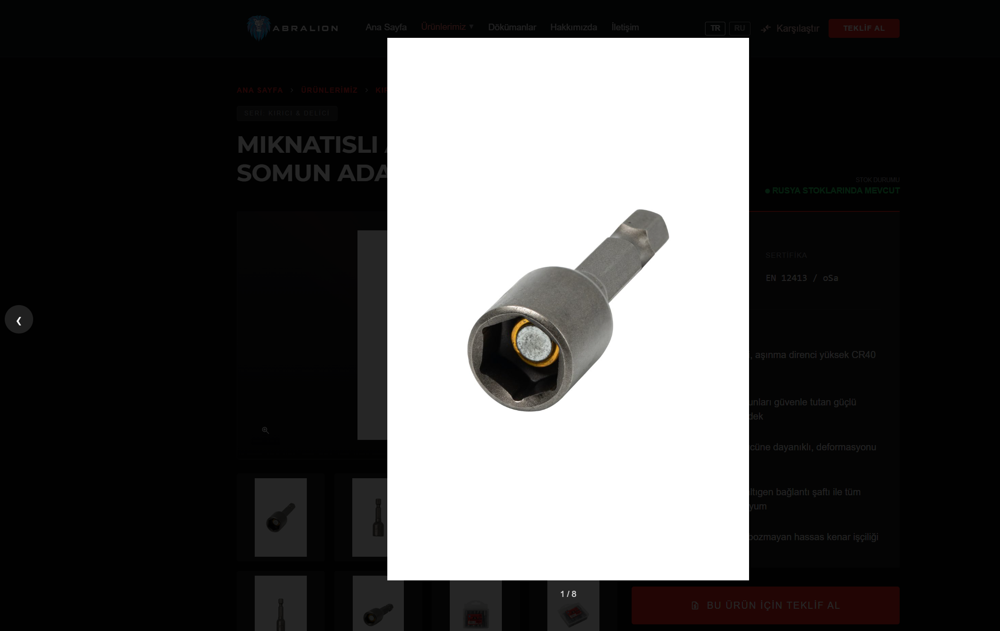

# A1a — görsel pipeline pilotu

Kapsam: `miknatisli-anahtar-ucu` (galeri, siteye bağlı) ve `canak-firca-sacakli` (kart örnekleri, siteye bağlı değil). Kaynak klasör `C:\Users\mosta\Desktop\abralion-kasim-2026-fotograflar` salt okundu. `data/katalog-kasim2026-icerik.json` bu turda yalnız slug referansı; metin ve varyant yazılmadı.

Script: `scripts/ingest_kasim2026_photos.py`. Çalıştırma: `--only miknatisli-anahtar-ucu --replace-legacy --write-catalog`, ardından `scripts/sync_catalog.py`. Kartlar: `--cards canak-firca-sacakli`.

## Üretilen dosyalar

Kaynakta 9 jpg vardı. `DSC_8867 (1).jpg` kopyası elendi. 8 kare üretildi. Ana kare A0’daki yumuşak-şüpheli listesinde olmayan `DSC_8859-редакт.jpg` (soket ve mıknatıs görünür). Sıra: 8859, 8856, 8865, 8867, 9061, 9069, 9073, 9075.

Klasör `assets/images/products/miknatisli-anahtar-ucu/`:

| | Dosya | Bayt | MB |
| --- | ---: | ---: | ---: |
| Önce | 15 | 555479 | 0.53 |
| Silinen | 8 | 436599 | 0.42 |
| Yazılan | 53 | 746616 | 0.71 |
| Sonra | 60 | 865496 | 0.83 |

Yazılan 53 dosyanın dağılımı:

| Set | Adet | Bayt |
| --- | ---: | ---: |
| Galeri tam boy, uzun kenar 1600 (`-galeri-NN.{avif,webp,jpg}`) | 24 | 588984 |
| Galeri küçük, uzun kenar 480 (`-galeri-NN-thumb.{avif,webp,jpg}`) | 24 | 103245 |
| Ana `{slug}.webp`, uzun kenar 1200 | 1 | 9150 |
| `-cover.jpg`, `-og.jpg`, `-wa.jpg` (1200×630, `#0A0A0A` pad) | 3 | 45021 |
| `-menu-thumb.webp`, uzun kenar 64 | 1 | 216 |

Örnek ölçü: `galeri-01.jpg` 1064×1600, 40017 bayt; webp 15278; avif 8923. Paylaşım üçlüsü aynı kareden, her biri 1200×630 ve 15007 bayt. Ana webp 798×1200. Menü küçük resmi 43×64.

EXIF Orientation yoktu; döndürme uygulanmadı. Çıktılar sRGB, dosya adları küçük harf. Kalite: tam boy avif 50 / webp 75 / jpg 82; küçük resim avif 70 / webp 75 / jpg 80.

RU klasörüne dokunulmadı.

## Silinenler

Kart ve kart-card durdu. Silinenler (sonra yeniden üretilenler ayrıca işaretli):

| Dosya | Bayt | Sonra |
| --- | ---: | --- |
| `miknatisli-anahtar-ucu-card.avif` | 10076 | silindi |
| `miknatisli-anahtar-ucu-card.webp` | 14974 | silindi |
| `miknatisli-anahtar-ucu-manyetik-somun-adaptoru-kullanim.jpg` | 151429 | silindi |
| `miknatisli-anahtar-ucu.webp` | 22860 | yeniden üretildi |
| `miknatisli-anahtar-ucu-cover.jpg` | 139275 | yeniden üretildi |
| `miknatisli-anahtar-ucu-og.jpg` | 49588 | yeniden üretildi |
| `miknatisli-anahtar-ucu-wa.jpg` | 45381 | yeniden üretildi |
| `miknatisli-anahtar-ucu-menu-thumb.webp` | 3016 | yeniden üretildi |

Korunanlar: `.gitkeep`, `miknatisli-anahtar-ucu-kart.jpg`, `*-kart-card.avif/webp`, ve aynı desene uyan `miknatisli-anahtar-ucu-manyetik-somun-adaptoru-kart.jpg` ile onun kart-card çifti (190×110, 7006 bayt).

## Katalog zinciri

`data/products.json` ve `assets/js/products-data.js` içinde yalnız bu ürünün `images[]` dizisi değişti: 8 kayıt, `src` `...-galeri-NN.jpg`. Diğer alanlar aynı. `scripts/sync_catalog.py` doğrulaması OK. Kök `products-data.js` kopyalandı, `products-data.min.js` 60501 bayt, HTML sorgu `?v=49c6ee7e`.

## Galeri, lazy

`product-detail.js` Kasım galeri yolunu (`-galeri-NN`) küçük resme çevirir: slayt ve thumb `src` `...-galeri-NN-thumb.webp`. `data-full` tam boy jpg. `data-gallery-src` thumb yoludur; yedek adaylar da thumb setinde kalır. Thumb’ların hepsi ve 2–8. slayt `loading="lazy"`. İlk slayt LCP için lazy değil; o da thumb webp.

`gallery-lightbox.js` `collectImages` tam boyu `data-full` üzerinden alır.

Yerel sayfa: `http://127.0.0.1:8765/urun/miknatisli-anahtar-ucu.html`.

İlk yükleme (16:42) galeri istekleri yalnız 8 `*-galeri-NN-thumb.webp` (hepsi 200) ve kart jpg. Tam boy (`-galeri-NN.jpg/webp/avif`) listesi boştu. 8 slayt ve 8 thumb `complete`, yükseklik 480. Kırık görsel yok. Sunucu günlüğünde 4xx/5xx yok.

Lightbox açılınca tek istek geldi: `miknatisli-anahtar-ucu-galeri-01.jpg`, doğal ölçü 1064×1600. İkinci ve üçüncü açılışta da tam boy inmeden yalnız thumb’lar istendi.

## Kart örnekleri

`canak-firca-sacakli`, A0 karesi `DSC_9025-редакт.jpg`. Hedef oran 692×400 (190/110 ≈ 1.73). Siteye bağlanmadı. `rembg` yüklü değil; B varyantı beyaz eşik maskesi.

| Dosya | Bayt |
| --- | ---: |
| `scripts/raporlar/a1a-kart/beyaz-studyo-kirpim.jpg` | 53101 |
| `scripts/raporlar/a1a-kart/koyu-kompozit.jpg` | 43145 |
| `scripts/raporlar/a1a-kart/karsilastirma.jpg` | 147245 |

Karşılaştırma: mevcut `miknatisli-anahtar-ucu-kart.jpg` | A | B.

## A1b

Kalan 12 foto klasörü, 4 yeni ürün klasörü ve kardeş bağlama (düz keski Plus, sivri murç Max) bu turda yapılmadı. Onay bekler.
